# Leaflet: a cozy Animal Crossing: Wild World save editor

**The most complete save editor ever made for *Animal Crossing: Wild World*.** Every byte of your town is mapped and
editable, wrapped in a cozy, DS-style interface for macOS and Windows. It works offline and needs no installer.

[**⬇︎ Download for macOS or Windows**](https://github.com/oddnebula/leaflet-wild-world/releases/latest)

## ✨ Only in Leaflet

No other Wild World editor we know of has these:

- 🧬 **Every byte of the save mapped.** The whole 90 KB town block is laid out field by field from the game's
  decompilation, and all eight checksums are kept valid. Nothing is left as "unknown".
- 🏠 **Your house and neighbors in 3D**, rendered from the game's own models and placed exactly as in your save.
- 🎶 **Your town's hourly music and every K.K. song**, played with the game's own instruments.
- 📅 **A real town calendar.** Every festival, birthday and visitor is worked out from the game's own event schedule
  for any year, and you can export it to Apple Calendar, Google Calendar or Outlook.
- 🌞 **Today in Town**: the game clock, hourly weather, turnip prices, visitors, and what's out to catch right now.
- 📔 **A Town Diary.** Leaflet watches your save while you play, keeps every version, and writes your town's story
  from them: who moved in, what you caught and donated, loans paid off.
- 🎨 **A pattern studio** with layers, mirror drawing, a palette swapper, picture and New Leaf QR import, and a library
  of every design from every version of your town.
- 📖 **A catalog with the game's real prices**, series, colors and Happy Room Academy points, plus a set tracker.
- 🩺 **Save Doctor**, which finds and fixes the broken states old editors and cheat codes leave behind.
- 🪪 **A shareable town card**: one image with your map, fruit, tune, flag, residents and neighbors.
- ✨ **Editors for things nobody else touches**: Celeste's constellations, the bulletin board, the post office,
  furniture switches and gyroid beats, Mom's letters, villager hobbies, and every one of the game's event flags.

Compared with the open-source Wild World editors we know of (ACSE, LeafEdit, WildEdit, WildStorage and
ACWW-Web-SaveEditor) as of October 2026. The 3D models, music and real prices need a ROM backup of your own
cartridge. Everything else works with just a save file.

Works with USA and European saves (256 KB `.sav` files from flashcarts, DeSmuME, melonDS and save dumpers).
Japanese and Korean saves use a different layout and are not supported.

> [!IMPORTANT]
> **Leaflet includes no ROMs and no Nintendo content, and never will.** It edits save files and works without a ROM.
> If you choose to open a ROM for the game's art and sound, it must be **a backup you dumped yourself from an *Animal
> Crossing: Wild World* cartridge you own**. Don't download ROMs. Requests for ROMs will be closed without a reply.
> Not affiliated with or endorsed by Nintendo. See [LEGAL.md](LEGAL.md).

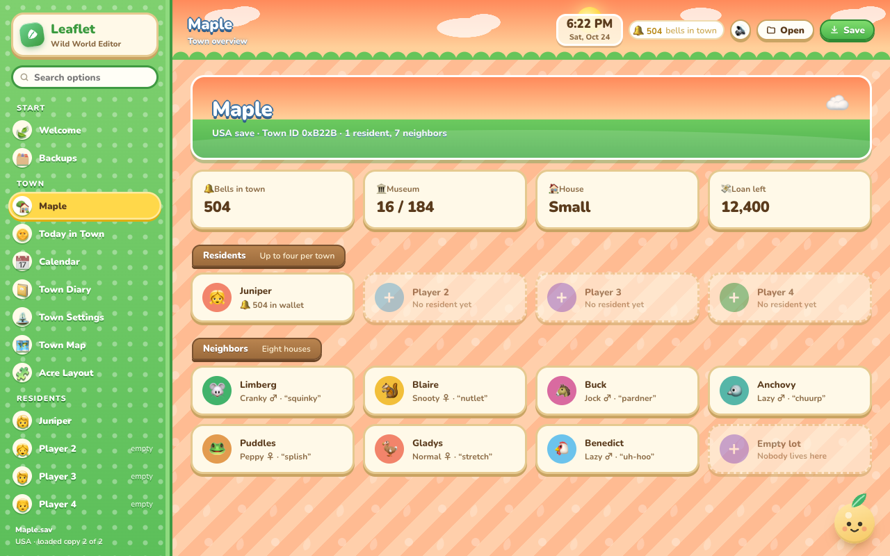

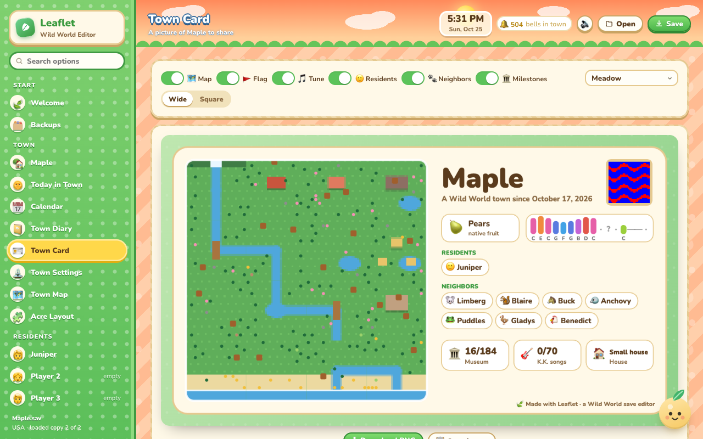

| | |
|---|---|
| 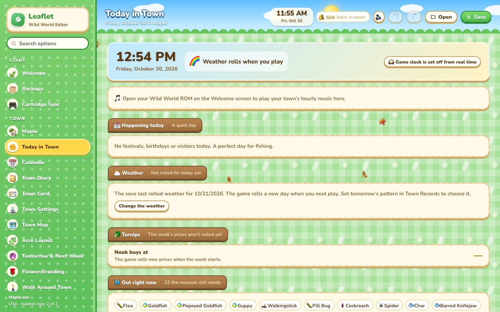 **Today in Town**: the game's clock, weather, turnips and what's out now | 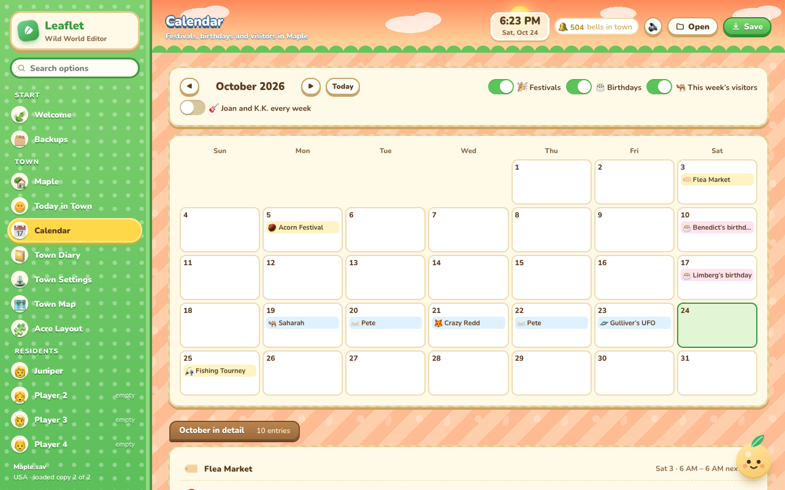 **Calendar**: festivals, birthdays and visitors, with .ics export |
| 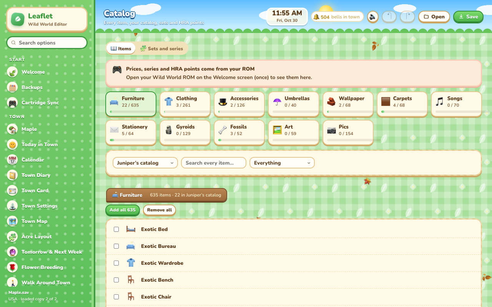 **Catalog**: every item, with set tracking | 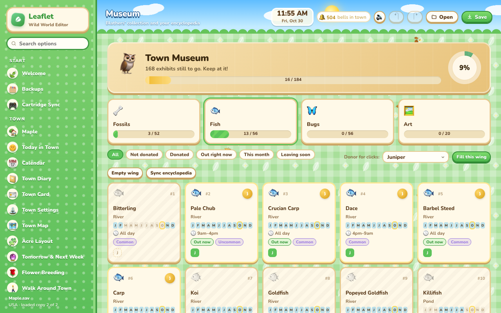 **Museum**: donors, months, hours and rarity for every exhibit |
| 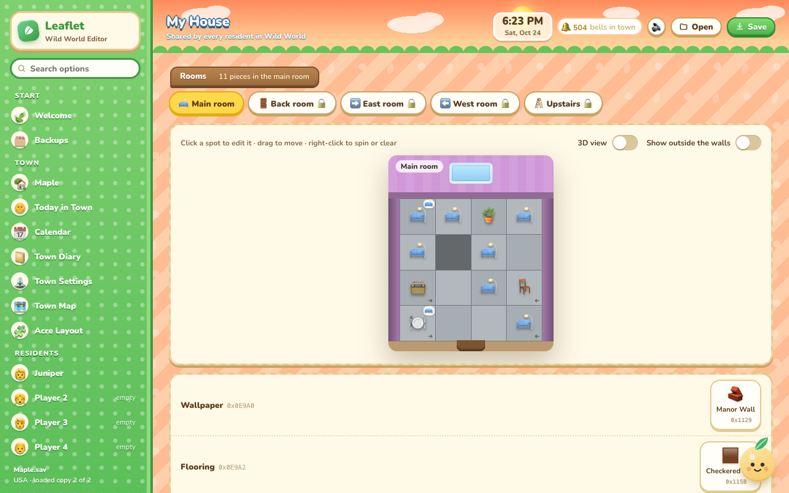 **My House**: drag furniture between rooms, or view a room in 3D with your ROM | 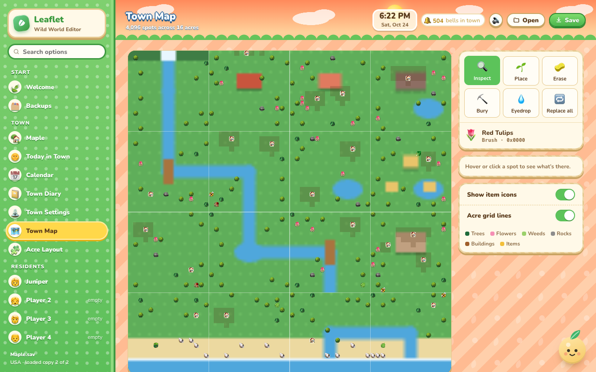 **Town Map**: all 4,096 spots, editable |
| 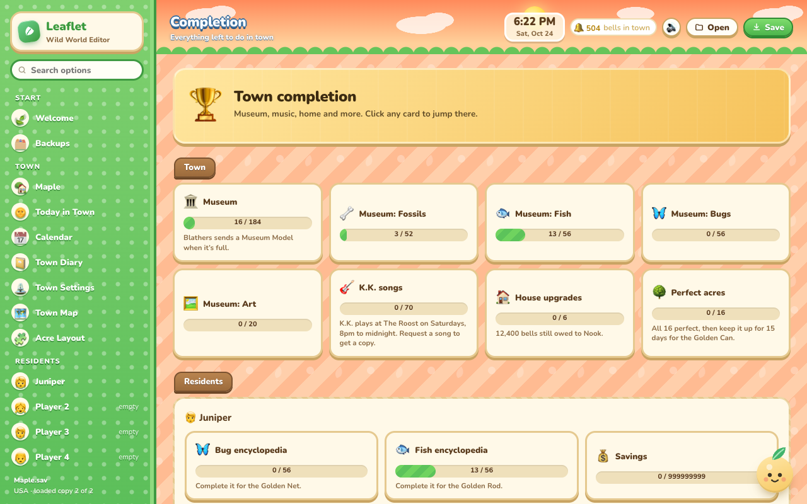 **Completion**: museum, catalog, songs and golden tools | 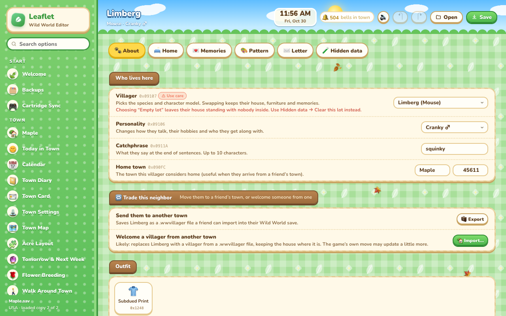 **Neighbors**: species, personality, hobbies, home and memories |
| 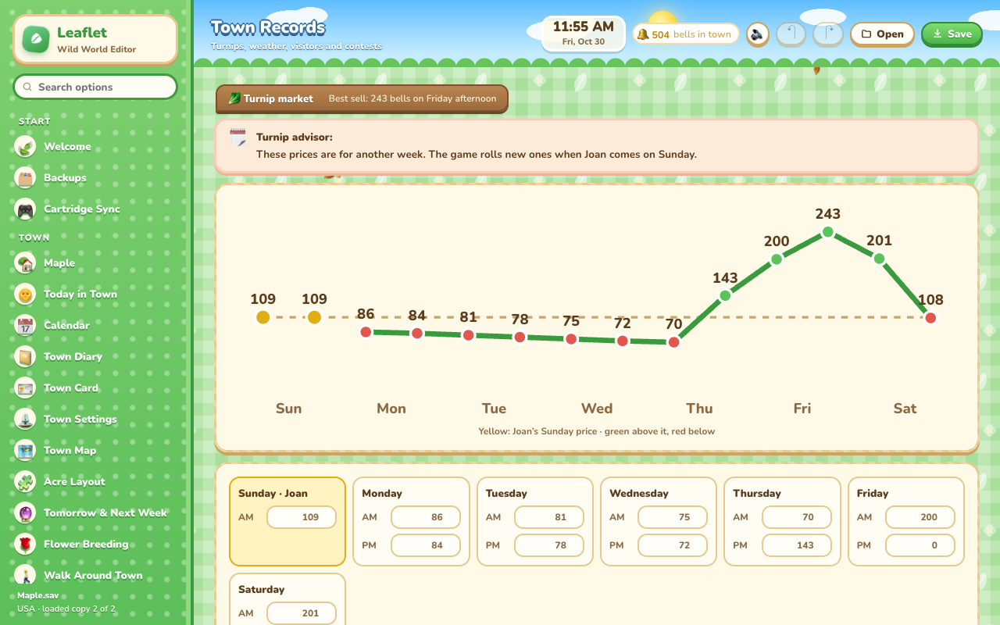 **Town Records**: turnips, weather, the game clock and visitors | 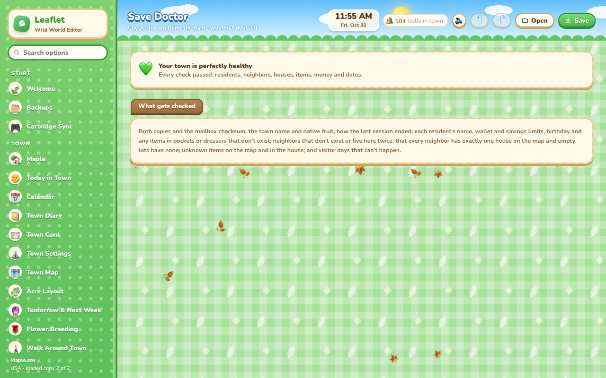 **Save Doctor**: finds and fixes impossible states |
| 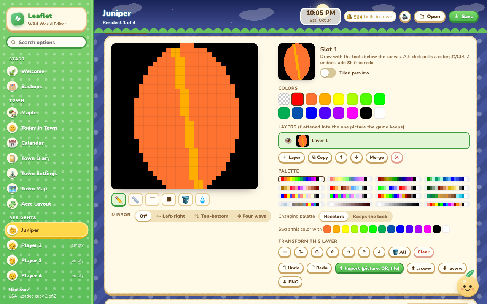 **Pattern studio**: layers, mirror drawing, tools and a palette swapper | 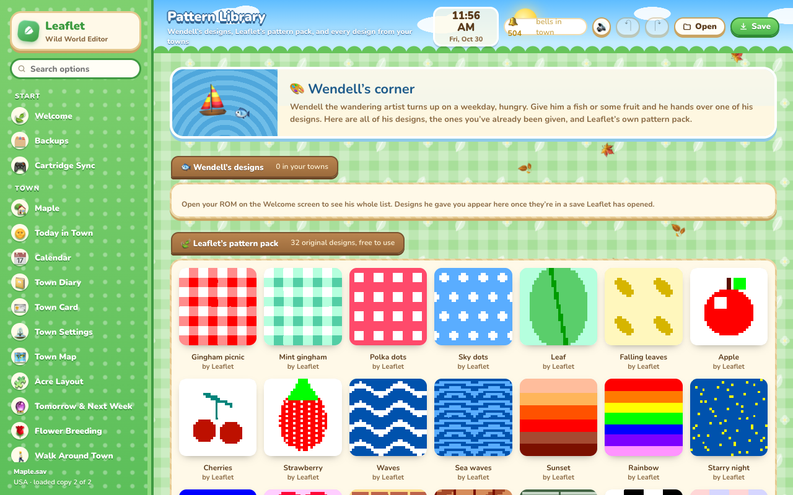 **Pattern library**: every design from every backup |
| 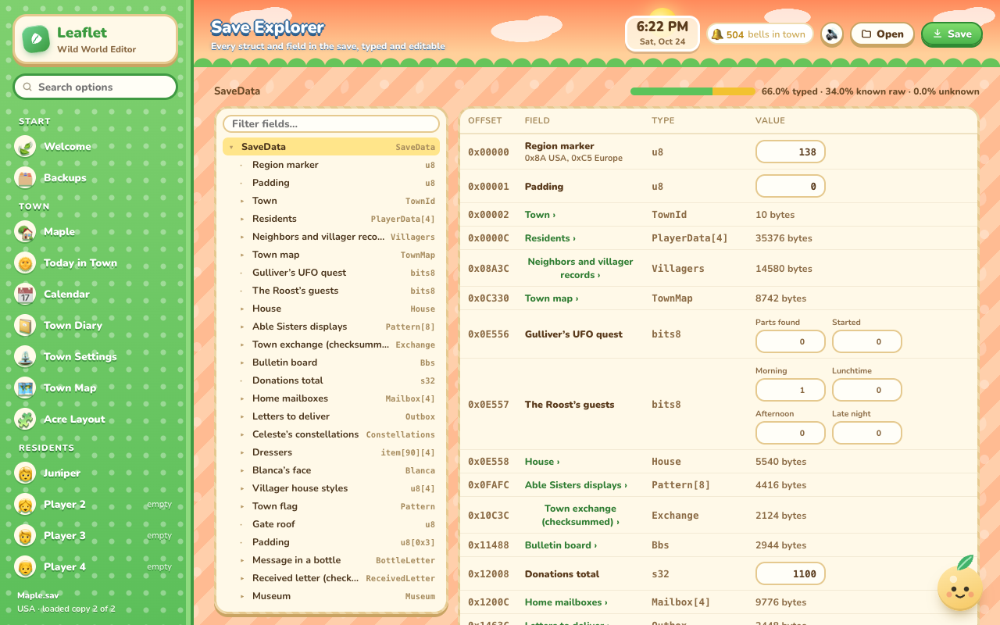 **Save Explorer**: every byte, typed and editable | 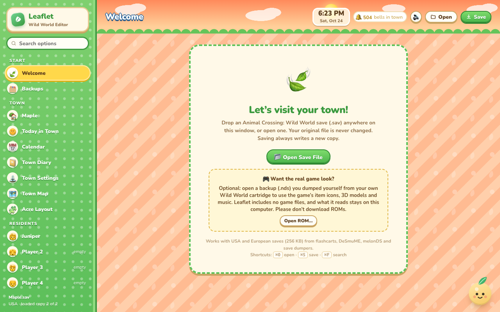 **Welcome**: open a save, with an optional ROM backup |

Screenshots show Leaflet **without a ROM**: every icon and drawing is Leaflet's own (emoji, CSS and SVG), and the
town and resident names come from a renamed demo copy of a save. The designs shown are generated by code, not the game's. With your own ROM backup, the game's icons, 3D models
and music appear instead, on your computer only.

## Running it

Download the latest build from [Releases](https://github.com/oddnebula/leaflet-wild-world/releases): `Leaflet-macOS.zip` or `Leaflet-Windows.zip`. Or clone the repository and open `index.html`.

- **macOS:** open `Leaflet.app`. The first time, right-click it and choose **Open**, since the app is signed locally rather than by a registered developer.
  You can also drag a `.sav` file onto the Dock icon.
- **Windows 10/11:** double-click **Start Leaflet.cmd**. It opens Leaflet in its own Microsoft Edge app window (Edge comes with Windows).
- **Any computer:** open `index.html` in Chrome, Edge, Safari or Firefox.

Shortcuts: ⌘/Ctrl-O open · ⌘/Ctrl-S save a copy · ⌘/Ctrl-F search every option.

## Game art and sound from your ROM

Leaflet ships with **no Nintendo artwork, models, music or sound**. If you have dumped your own *Wild World* cartridge, open that backup (`.nds`) once from the Welcome screen, or drop it on the window, and Leaflet reads what it needs straight from it. Use only a backup of a cartridge you legally own ([LEGAL.md](LEGAL.md)).

What it adds:

- the real pocket icons for every item, and the encyclopedia pictures of every fish and bug
- the game's pocket screen, drawn exactly as on the DS, with your items placed in its slots
- **3D villagers**, rendered from their actual models and wearing the shirt from your save, and their **real room layouts** (the game's 40 furniture arrangements, with the pieces they have on display)
- **your resident in 3D**: body, hairstyle, hair color, face, tan, shirt (including custom designs), hat, glasses and the tool or umbrella in their hand (custom umbrellas show your design), assembled the way the game does it
- every letter drawn on its **real stationery** (all 64 papers)
- **your house in 3D**: every room with the game's own furniture models, wallpaper and flooring, placed and turned exactly as in your save, and you can drag to look around
- **K.K. songs** played with the game's own instruments, in the stereo (aircheck) or live-at-the-Roost version
- the game's own **sound effects** for every click, tab, popup, confirm and error, and Animalese from the game's voice samples

The extracted files stay on your computer (in the browser storage of Leaflet's window, which the Mac app keeps between launches) and are never uploaded. Without a ROM, Leaflet still edits everything and falls back to its own emoji, drawings and synth sounds. *Forget game art* on the Welcome screen removes the cached files. When a new version of Leaflet reads more from the ROM than your cached copy holds, the Welcome screen asks you to open the ROM once more.

## Is it safe?

- Your original file is never changed. **Save** always writes a copy, and Advanced → *Download untouched backup* gives you the exact bytes you opened.
- Saving follows the game's own rules, confirmed in the decompilation. The editor refreshes the main checksum and all six inner checksums the game keeps, plus the town hall mailbox checksum. It writes both internal copies identically, so the game loads your edits, and it checks the result before writing.
- Anything not fully researched carries a purple **Research** / **Likely** / **Inferred** badge. Edits that can break a save (town and player IDs, acres, buildings on the map, raw house coordinates, raw writes, the save generation byte) show a red **Can break your save** badge and ask before the first change.

Still, back up your save before playing an edited file.

## What you can edit

| Area | Options |
|---|---|
| Town | Name (optionally renamed on every resident too), town ID, grass pattern and ground season, gate roof color, **native fruit**, a **town tune composer** with playback, the day the town was founded (and its first-day flag), and whether the last session ended with a proper save (Mr. Resetti) |
| Groundskeeping | Pull weeds, water or revive flowers, regrow fruit, dig up buried items, tidy dropped items, remove rocks, fill holes, plus a perfect-town check for each acre |
| Town map | All 4,096 spots: place, erase, bury, eyedropper, replace-all, with an inspector showing each spot's acre and coordinates |
| Acres | All 36 acres as a visual grid with original thumbnails, plus raw ID paste |
| Residents (×4) | Name, gender, player ID, home town, birthday, last-played date, hairstyle, face, hair color, tan, today's fortune, 4 emotions, default letter greeting and sign-off. Counters the special characters keep: chats with Sable, Roost visits and part-time job, haircuts, Mr. Resetti visits, Gracie's style score, insurance claims, balloons shot, acorns and acorn prizes, fireworks handed out, Fishing Tourney and Bug-Off entries, festival gift, last insurance payout, last Roost shift and Mom's last letter. The friend who moved away and still writes |
| Money and gear | Wallet, savings, Nook Points, Acorn Festival acorns, held tool, shirt, hat, face accessory, bed, pocket-screen design. Options (stereo, talking voice), the future-self greeting, birthday reminders per neighbor, which of Mom's letters have arrived (with a reset), the last show watched and your Katie escort record |
| Pockets and outfit | The game's pocket screen with 15 pockets, 10 letters and the wallet, your resident in their outfit (hat, glasses, shirt, held item), bed, pocket background, hair, face and tan, plus 90 dresser slots |
| Patterns | 8 per resident, plus the Able Sisters' displays, the town flag, each neighbor's design and Blanca's face, all in the **pattern studio**: up to 8 **layers** (show, hide, reorder, copy, merge; flattened into the one picture the game keeps), **mirror drawing** (left-right, top-bottom or four ways), pencil, line, box, filled box, bucket fill and eyedropper, flips, turns and wrap-around shifts for seamless tiles, a **tiled preview**, undo and redo, and a **palette swapper** (switch palette by recoloring or by keeping the look, and swap any two colors everywhere). PNG import (matched to the closest palette automatically), New Leaf QR codes, PNG and `.acww` export, name, creator, concept, “make it mine” |
| Pattern library | Every design found in every version Backups has kept and in the open save, each shown once: residents', the Able Sisters', town flags and neighbors'. Search by name or creator, filter by where it was found or which town, see everywhere it appeared, download it as PNG or `.acww`, or copy it into any pattern slot of the open save |
| Mail | 10 pocket letters, 10 in the mailbox at home, the letter to your future self (with delivery date) and 75 town hall letters for each resident. Every field is editable: sender, recipient, IDs, greeting, body, sign-off, stationery (shown on the real paper with a ROM), present, the letter's state (draft, unread, read, bottle, from a villager), whether the present is still wrapped, template kind and sender/recipient kinds |
| Catalog and encyclopedia | Fill or clear the catalog, every bug and fish individually, and raw catalog bits |
| Catalog browser | Every item the catalog can hold (furniture, clothing, accessories, umbrellas, wallpaper, carpets, songs, stationery, gyroids, fossils, art, pics) with each resident's catalog ticks, search, “not in my catalog” and “in the house now” filters, and add-all. With a ROM: the game's price, series, theme or set, two colors and Happy Room Academy points for each item, sortable. A **set tracker** shows every series, theme and set with what's registered, what's in the house and the HRA bonus a full set is worth |
| Today in town | Your town's **hourly music** from the ROM (following the game clock and changing on the hour, or any hour you pick, looping). The game's own date and time (your clock plus the save's offset), what's happening today, the hour-by-hour weather if the day has been rolled, today's turnip price (or Joan's), what the museum still needs that's out right now, Crazy Redd's day, the Roost, a sick neighbor, birthdays, and the next two weeks |
| Town diary | Your town's story, told by comparing each kept backup with the one before: residents and neighbors moving in and out, hobbies, first catches, catalog additions, museum donations (and who made them), bells earned and spent, Nook Points, loan payments, house upgrades, K.K. songs learned, town hall donations, a new town tune or flag, and the perfect-town streak |
| Town card | One shareable picture of your town, drawn entirely by Leaflet (no game art): the map from above, native fruit, town tune, flag, residents, neighbors and milestones. Wide (1200×675) or square (1080×1080), four color themes, any section can be turned off. Download as PNG or copy to the clipboard |
| Calendar | A month grid of every festival (Fishing Tourney, Bug-Off, Flower Fest, Fireworks, Acorn Festival, Bright Nights, flea markets, La-Di-Day and Yay Day, New Year), every resident's and neighbor's birthday, this week's visitors, Joan and K.K., resolved for any year from the game's own event schedule. **Export to .ics** for Apple Calendar, Google Calendar or Outlook |
| Hidden flags | Mr. Resetti pending flag (and clearing it for everyone); **today's chats** (Celeste, Gracie, Wendell, Saharah, Mabel, Pascal, Lyle, Tortimer's events, Gulliver) with a “fresh day” reset; **errands** (both favors with their villagers, the Roost part-time job and its customers, the parcel to deliver, house-visit invitations, “call off”); **Wi-Fi friends** (names and towns, clear the roster, checksum kept valid); bit-level editors for every resident block |
| Neighbors (×8) | Species, personality, catchphrase, home town, shirt, umbrella, **current hobby** (with the eight hobby scores, pending scores and when it was set), a planned favor for a resident, a room view of their house (wallpaper, flooring, 10 furniture pieces, which pieces are on display, room layout, furniture taste), moving their house on a mini map (the building, its footprint and their stored position move together), 4 held items, where they moved from |
| Villager memories | Each memory slot: friendship, nickname, compliment, greeting, last chat, last gift, impression, the town tune they hum, talk streak and 9 named flags (letters, gifts, birthday and New Year letters, parties, flea market) |
| Friendships | How every pair of neighbors gets along, as an editable chart, and the town tune request. Who's outside now and the going-out order, last move-in and move-out, the last neighbor to leave, the nickname cooldown, the four house exterior styles, and every villager who has ever lived here (the game won't pick them again; clear it to let anyone move in) |
| More for neighbors | Their pattern, their letter, clearing a lot, the villager moving in from another town (with their hobby and plans) |
| House | A **3D view** of each room with the game's own furniture models, wallpaper and flooring (with your ROM), and in-game style rooms sized to your house level: drag to move, right-click to rotate, both layers shown at once. Wallpaper, flooring, music per room, house size, pending upgrade, current / requested / after-upgrade roof color, lights per room, loan (with the game's own amount for each size), **furniture switches** (lamps, stereos, jack-in-the-boxes) as a clickable grid per layer, the gyroids' beat settings, and custom-design wallpaper/flooring flags |
| K.K. songs | Unlock every song or toggle each one individually, and listen to any of them (stereo or live) with a ROM |
| Museum | All 184 exhibits (52 fossils, 56 fish, 56 bugs, 20 paintings), with the donor of each (a resident, or “former resident”). Fill a wing or the whole museum |
| Town records | Turnip prices as a chart with every AM/PM price, pattern, big-spike price and dates. **Weather** for today and tomorrow as hour-by-hour strips (32 patterns from the game). The **game clock** (the save's offset from the DS clock: time travel by days, hours and minutes, or back to DS time). The perfect-town streak (golden watering can), Gulliver's UFO parts, the sick neighbor and how long they've been ill, town hall donations, Katie (or Kaitlin) and her home town, who visits the Roost today, Crazy Redd's stock and last sale, and Tortimer's contest record. A **calendar** with Crazy Redd's day, the week's five visitor slots (day, visitor by name: Saharah, Katrina, Gracie, Wendell, Pascal, Dr. Shrunk, Crazy Redd, Gulliver's UFO, Pete; state, who was there) with a re-roll, the town's event records, each resident's last-played date and the Happy Room Academy date, plus the three **snowmen** (size, rank, age). Town event records show their start and end as month, day and hour, and the event shared while playing online is editable |
| Shops | Nook's 37 shelf slots with sold marks, sale hour, bells spent, point-special day and renovations, and the **town's rarity ranking** (which of the classes A, B and C each of the 9 shop lists stocks most); the Able Sisters' accessories and 8 displays; town flag, Blanca's face, lost and found, recycling bin |
| Museum | A wing for each of fossils, fish, bugs and art, with progress bars, a donor stamp on every exhibit, and month dots, hours, location and rarity for each fish and bug. Filter by not donated, out right now, this month or leaving soon. Toggle each resident's encyclopedia straight from the cards |
| Now Catchable | Every bug and fish out at any date and hour you pick (defaults to now), with each one's spawn chance from the game's own tables. Shows what's out later today, what's leaving soon, a countdown to when each missing critter returns, and a chart of what you still need month by month. Tracks either the museum or one resident's encyclopedia |
| Completion | Dashboard of the museum, K.K. songs, house upgrades, perfect acres and each resident's encyclopedia, catalog, gyroids and villager pics, plus a Golden Tool checklist (from the game's event flags, and by finding the tools in pockets, dressers and the house) with how to get each one. A **fossil assessor** finds unassessed fossils in pockets and dressers and turns them into ones the museum still needs |
| Event flags | All 64 per-resident and 32 town event flags from the decompilation, with names where they could be identified (golden tools received, store upgrade notices, Museum Model, Resetti and more) |
| Post office | The 10 letters waiting for delivery and the last delivery round, the **message in a bottle** (with the game's used-message bits and a reset), the letter from another town and the letter traveling with a moving villager |
| Bulletin board | All 15 posts as editable text with their date, who has read each one and whether a resident wrote it; post count, current notice, the notices and slogans already posted, the day notices were last posted (or “never”, to post everything again) and whether notices have started |
| Celeste's sky | All 16 constellations drawn on the game's 64×32 star grid: click any of its 454 line segments to add or remove it, rename it, change its maker, free the slot or mark it unseen; plus a constellation arriving from another town |
| Backups | Automatic: every save you open or write is kept as a version (identical ones only once), unsaved edits are kept every minute and offered back on the Welcome screen if the window closed first, and the open save file is **watched**: each time the game or an emulator writes it, that version is kept too (Mac app, or Chrome/Edge when opened with the Open button). Open, download, star (keep forever) or delete any version; choose how many to keep per town; the Mac app also copies each one to Documents › Leaflet Backups |
| Pattern import | Pictures (cropped or fitted, best palette chosen automatically, optional dithering), New Leaf / Happy Home Designer QR codes from a screenshot or photo, and `.acnl` / `.acww` files |
| Save Explorer | A developer view of the whole save as typed structs from the decompilation: a tree of every record, each field with its offset, type and an inline editor (numbers, text, items, bitfields, and paged bit editors for raw blocks of any size), and a **hex view you can type into** (click a byte, Tab to the next) that pages through any record 1 KB at a time. Every byte of the main block can be edited here, and every byte is mapped to a named field (the few the game never reads are marked as padding) |
| Save Doctor | Checks for states the game never makes itself (usually from old editors or cheat codes) and explains each, with a fix where it's safe: items that don't exist in pockets, dressers, the house or on the map, wallets and savings over the limit, impossible birthdays and native fruit, unknown or duplicate neighbors, neighbors without a house (or lots with an extra one), visitor days that can't happen, a missing town or resident name, and damaged copies or checksums |
| Advanced | Save health, a map of every region in the save with a hex editor that highlights your changes, raw writes, save-vs-save diff for discovering flags, and backups |

## Look and feel

Leaflet borrows Wild World's own look: scrolling patterned backdrops, a top screen whose sky follows your clock (morning, afternoon, sunset, starry night) with drifting clouds and a sun or moon, falling blossoms, leaves or snow depending on the season, chunky cream menu panels, wooden section tabs and speech bubbles with a name tag. Motion turns off automatically if your system is set to reduce motion. Everything in this repository is original CSS, emoji and drawing code; the game's own art and sound only appear once you open your ROM.

## For the curious: research notes

Offsets came from the public editors and were checked against a real save and the USA (ADME Rev 1) decompilation.
Things the decompilation confirmed that earlier editors had missing or wrong:

- The game loads copy 2 when both copies are valid and their generation bytes (0x15FDF) match, and copy 1 otherwise. Editors that always read copy 1 can show stale data.
- There are inner checksums at 0x10C3C (0x84C bytes), 0x15C58 (0xF8 bytes, stored as one byte), and two per resident (+0x1E10, +0x1E60).
- Museum layout: fossils, then fish at +0x1B, bugs at +0x38, paintings at +0x55, one nibble per exhibit with the low nibble first. Value 5 means a former resident donated it.
- Resident appearance bits: 0x223C is face (low) and hairstyle (high); 0x223D is hair color (3 bits), tan (3 bits) and today's fortune (2 bits). The last-played date at 0x2216 packs year, month and day into 7, 4 and 5 bits.
- Corrections to the docs: room wallpaper is at +0x448 and flooring at +0x44A (the reverse of what was documented); pocket letters start at player +0x1148; the grass byte at 0xE554 is the grass pattern in its low 2 bits and a ground-season value in the other 6.
- House state is a 32-bit bitfield at 0xFAF8: size (3 bits), size being built (3), roof color now / requested / after the upgrade (4 each), lights per room (6), and a counter (8).
- Event flags: 64 per resident at +0x21FC and 32 for the town at 0x15FD8.
- A neighbor's house is building 0x5001 + their slot on the map; their stored position is the map spot + 16, and the house footprint is a fixed 4×3 block plus a doorstep.

The whole main block is now laid out field by field from the decompilation's `SaveData` (see `js/schema.js` and the Save Explorer). Highlights:

- Town tune: 16 nibbles packed into a u64 at 0x15FA8 (0–12 low G to high E, 13 random, 14 hold, 15 rest). Native fruit: u32 at 0x15E58 (0 apple … 4 cherry). Perfect-town streak: 0x15E75.
- Weather at 0x15F66: date, today's and tomorrow's pattern (32 patterns, each a 24-hour strip from 6 AM), hour base and a rained flag.
- 0xE556 is Gulliver's UFO-parts quest (3-bit count, started flag); 0xE557 is the Roost's guests of the day (morning, lunchtime, afternoon, late night).
- Villager memories (0x68 bytes): player ID at +0, nickname +0x16, compliment +0x1E, greeting +0x2E, last talk +0x40, their town +0x48, last gift +0x52, friendship (signed) +0x54, impression +0x55, topics +0x58, your town tune +0x5C, flags +0x64. Earlier notes put the nickname at +0x18; the decompilation shows +0x16.
- Villager record: shown-furniture mask +0x6EA, move-in kind +0x6F0, furniture taste +0x6F1, room layout +0x6F2 (one of 40 layouts in the ROM). Neighbor friendships: 28 signed scores at 0xC23C.
- Nook's shop: 37 stock slots, stock date, point-special day, renovation, and a bitfield at 0x15E0E with the sale hour, next paint color and store level. 0x15F84 is the Able Sisters' accessory stock (it was listed as a "daily item list" in an earlier version of this editor).
- Turnips at 0x15F4C: week start, purchase date, big-spike price, 14 prices, pattern. Tortimer's contest at 0x15EFC: resident holder, villager holder, voted villager, entry, score, date, type.
- Sound effects: `Snd_PlaySe(id)` plays sequence id % 1000 of sequence archive id / 1000 in `sound_dataENG.sdat`. Animalese uses archive 0, sequence 207 + syllable.
- Neighbor rooms: `fg_data/nr.bin` holds 40 layouts (10 entries each: item code, x, y on a 16×16 grid; `nf.bin` has 10 packed-to-move layouts). Codes 0xF000–0xF02F are furniture spots: slot = (code − 0xF000) >> 2, minus 2 from 3 up; facing = code & 3.
- Models: villagers are `npc/model/{species & 0xF8}/{species}`; residents combine `PBody`, `PHead` (hair, hat hair, hats, full headwear), `PFcTx` faces, `PPal` skin (tan + face × 8) and hair (0x80 + color × 8 + tan) palettes and `PGls` glasses. Held items 0x1369–0x13A7 index `sHeldItemModelIds` for `PItm/Mdl{x >> 5}/{x}` and hang from the body's `Rhand` bone; custom umbrellas use the `myD` texture.
- Stationery: `menu/paper/{scr,chr,plt}/NNN` for paper NNN; the map numbers tiles from 16 and palettes from slot 12.
- Music: `SndMgr_PlayBgm(k)` starts SDAT sequence k. The town's hourly themes are `sHourlyBgmIds[hour]` = sequence 0x16 + hour. K.K. song item 0x1323 + i is sequence 176 + i on a stereo and 99 + i live (`FtrStereo::startSong`, the Roost show).
- Furniture models: `/ftr/{n >> 8}/{(n & 0xFF) >> 4}/{n:04x}.arc` (an LZ-compressed NARC holding the NSBMD, sometimes with BMA0/BTA0 animations) with textures in the matching `.nsbtx`; wallpaper `wall/wall_{k}.nsbtx`, flooring `carpet/floor_{k}.nsbtx`. A room tile is 2 units. Footprints (ftr_info byte 5) are 1×1, 2×1 (reaching along the piece's own +x after turning by direction × 90°) or 2×2 (drawn at the middle of the four tiles); the other tiles hold 0xF031. Items on the top layer sit at the height in ftr_info/dma byte 3 ÷ 16.
- Clock offset at 0x15FB4: s32 minutes and s16 seconds added to the DS clock (`Clock_ReadAdjusted`).
- Item class orders at 0x15FBC: one byte per shop list (furniture, stationery, shirts, carpets, wallpaper, accessories, hats, umbrellas, full headwear) picking one of six 60/30/10 weightings of classes A, B and C.
- Weekly visitor schedule at 0x15E18 (0x3C bytes, `EventWeekSlots`): four dates, Crazy Redd's weekday, today's event, and five slots of date, event, state, happened, residents present.
- Daily talk flags at resident +0x21F0: a date and 64 “already today” bits (2 Celeste, 7–9 Gracie, 10 Wendell, 11 Saharah, 15 Mabel, 20 Gulliver, 24 Pascal, 28–31 Tortimer's events, 40 Lyle).
- Errands at resident +0x1D64 (`PlayerErrands`, 0xAC bytes): two favors, three Roost customers, on duty, a parcel and a house-visit invite. Errand kind 22 means none.
- Villager plan at +0x65C (`VillagerPlanBlock`): two timestamps, a state (0–7 the hobby they're into: bugs, fishing, fossils, clothes, furniture, gardening, shells, walking; 8 changing; 10 moving in), 8 hobby scores, 8 pending scores, and a planned errand.
- House rooms: +0x400 is two 16×16 furniture-switch grids (bit x of u16 row y, reset to all 1s; a switched lamp, stereo or jack-in-the-box reads 0), +0x440 the gyroid table (4 spots as x/y nibbles, an in-use mask, a 4-bit beat each), +0x44E bit 0/1 = wallpaper/flooring came from a custom design.
- 0x15FC5 is the town's founding date with a first-day flag; 0x15FDE is the save state (2 after a proper save, 0x1C when switched off without saving, which brings Mr. Resetti).
- Events: every id in `sEventSchedule` is named (`js/events.js`): 0–7 neighbor birthdays and 0x4B–0x52 their reminders, 8 your birthday, 0x09–0x13 the festivals (Fishing Tourney, Bug-Off, Flea Market, La-Di-Day, Yay Day, Flower Fest, Fireworks, Acorn Festival, Bright Nights, Countdown, New Year), 0x14–0x1B their hosts, 0x1C–0x24 seasonal bulletin notices, 0x25–0x5F the notices and talk before each festival, 0x3A K.K. on Saturday night, 0x3B Joan, 0x3C Lyle, 0x3D–0x45 the weekly visitors (Crazy Redd, Saharah, Katrina, Gracie, Wendell, Pascal, Dr. Shrunk, Gulliver's UFO, Pete). Schedule rules: bits 13–15 kind (fixed, your birthday, a neighbor's, fishing months, bug months, a fixed month, a weekly slot), 11–12 month mode, 8–10 week of the month, 4–7 month, 1–3 weekday.
- Weekly visitor slots store their day as month << 8 | day. Villager species history (0xC310, 160 bits) marks every villager who has lived in town; new move-ins are picked from the rest.
- Constellations list up to 16 of the 454 sky segments in `sConstellationLineCells` (each up to four cells on a 64×32 grid). Bulletin posts are 192 characters, a date and a flag byte (bits 0–3 read by each resident, bit 4 written by a resident).
- Furniture info lives in the ROM: `ftr_info/always.bin` (8 bytes per furniture index: series, two colors, collection group, class, …), `ftr_info/dma.bin` (0x1C bytes: price first), `item_info/always.bin` (12 bytes per 0x1xxx item: price, icon, …, series at +5) and `item_info/series.bin` (0x4A records of 20 bytes: kind 0 series, 1 theme, 2 set, 3 other, then the name). Happy Room Academy points per class are `sFtrClassBasePoints`; a full series scores 20,000 (25,000 with its wallpaper or carpet, 30,000 with both), a theme with its wallpaper and carpet (n + 1) × 3,000, a set n × 1,000.
- Catalog bits at resident +0x1B48 (`Catalog_GetBit`): furniture by index from bit 0, wallpaper at byte 0x100, carpets 0x109, songs 0x112, stationery 0x11B. The fish and bug models' bits hold the encyclopedia instead.
- Villager birthdays come from the species table (`sVillagerInfoTable`, 0x4E bytes each, month and day at +0x26), not the save. Town event records store their start and end as event-date words (hour in byte 1, day in byte 2, month in byte 3; 1 = none). 0x15EBC is the day the bulletin board last posted (0xFF = never) and 0x15E76 is set once it has started posting. 0x15E29 is the event shared while playing online.
- Sick villager at 0xC26C (0x90 bytes): an errand, the villager, five visitors, two dates and days sick. Letter status at +0xEE: state in the low 6 bits (1 draft, 2 unread, 3 read, 4–6 bottle, 7–8 from a villager) and the present's state in the top 2.

## Credits

Built on the work of ACSE by Cuyler36 (MIT; item, villager and acre lists, Wild World and New Leaf palettes), DrewPag's Wild World spawn-table research (bug and fish availability), jsQR by Cosmo Wolfe (Apache-2.0), WildEdit, LeafEdit and ACWW-Research by Universal-Team and SuperSaiyajinStackZ, WildStorage by NovaSquirrel (MIT), and the acww-decomp project.
Full credits and licenses: [THIRD_PARTY_NOTICES.md](THIRD_PARTY_NOTICES.md). Legal notice: [LEGAL.md](LEGAL.md). Leaflet's own code is MIT-licensed ([LICENSE](LICENSE)).
Not affiliated with Nintendo. Animal Crossing is a trademark of Nintendo.

### Sharing this project

The repository contains only original code and factual research data (save offsets, item IDs and names, spawn odds, weather probabilities, palette values), the same kind of data other open-source editors publish. It contains no ROM, no extracted artwork, models, music or sound effects, and `.gitignore` keeps `.nds`, `.sav` and `.sdat` files out. Everything copyrighted is read at runtime from a ROM the user dumped themselves.
